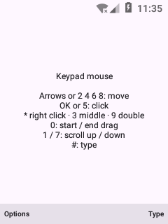
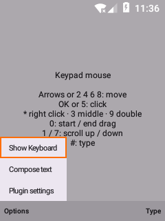
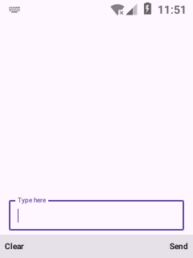
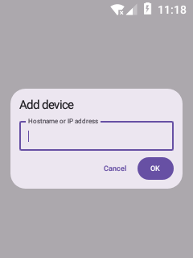
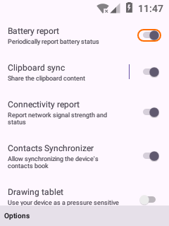
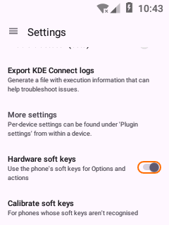
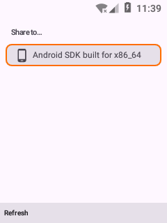

# KDE Connect for keypad phones (com.android.cts.kdeconnect)

A build of KDE Connect for Android that runs on **Android 7.1.1 phones with no touchscreen at all**, like the Kyocera Cadence S2720 flip phone. Every screen below was reached and used **with keys only**: the D-pad, OK, the two soft keys and Back. Nothing was tapped. The screenshots come from a 240×320, 160 dpi emulator with no touchscreen, the same as the Cadence.

The keypad experience follows [vela-dpad](https://github.com/alltechdev/vela-dpad):
- **Soft keys:** the left key is **Options**; the right key is the screen's main action. Back is the phone's Back key. The soft-key bar is [Yapchik](https://github.com/theOnionsAreWatching/yapchik) by theOnionsAreWatching.
- **Focus:** an orange focus ring hugs the highlighted control, and every screen opens with something already highlighted.
- **Space:** on-screen buttons the soft keys replace are removed to save room.

Touch phones look exactly like upstream KDE Connect. See [CHANGES-FROM-UPSTREAM.md](CHANGES-FROM-UPSTREAM.md) for everything that changed.

**Phone setup (once):** a keypad phone can't open some permission screens, so grant them over USB. Install the APK, turn on USB debugging, download [`cadence-phone-setup.sh`](https://raw.githubusercontent.com/alltechdev/kdeconnect-android-cadence/master/cadence-phone-setup.sh) and run these two commands in the folder you saved it to. They work the same in Windows Command Prompt, PowerShell, macOS and Linux:

```
adb push cadence-phone-setup.sh /data/local/tmp/
adb shell sh /data/local/tmp/cadence-phone-setup.sh
```

It keeps any other app's accessibility service and notification listener, and is safe to run again after reinstalling.

<table align="center">
  <tr><td align="center"><br><sub>1. Device list</sub></td><td align="center"><br><sub>2. Options menu</sub></td><td align="center"><br><sub>3. Device</sub></td></tr>
  <tr><td align="center"><br><sub>4. Device options</sub></td><td align="center"><br><sub>5. Media remote</sub></td><td align="center"><br><sub>6. Keypad mouse</sub></td></tr>
  <tr><td align="center"><br><sub>7. Mouse options</sub></td><td align="center"><br><sub>8. Compose text</sub></td><td align="center"><br><sub>9. Add device</sub></td></tr>
  <tr><td align="center"><br><sub>10. Plugin settings</sub></td><td align="center"><br><sub>11. Settings</sub></td><td align="center"><br><sub>12. Share</sub></td></tr>
</table>

1. **Device list**: opens with the first device focused (open the app)
2. **Options menu**: on top of the soft-key bar (Left soft key)
3. **Device**: first plugin focused (OK)
4. **Device options**: ring, ping, plugin settings, unpair (Left soft key)
5. **Media remote**: Play/Pause on the right key (→ OK)
6. **Keypad mouse**: the keypad drives the PC pointer (↓ OK)
7. **Keypad mouse options**: keyboard, compose, settings (Left soft key)
8. **Compose text**: Clear / Send on the soft keys (Options → Compose text)
9. **Add device by IP**: dialog opens focused (Options → Add devices by IP → Add device)
10. **Plugin settings**: the ring hugs the toggle (Options → Plugin settings)
11. **Settings**: soft-key switch and calibration (Options → Settings)
12. **Share**: first device focused (share from any app)

## Credits

- **[Yapchik](https://github.com/theOnionsAreWatching/yapchik)** by theOnionsAreWatching: the soft-key engine. It finds the phone's soft keys and draws the on-screen soft-key bar with their labels. It is included as source in [`yapchik/`](yapchik/) under the GNU LGPL v3 or later (see [`yapchik/LICENSE`](yapchik/LICENSE) and [`yapchik/NOTICE`](yapchik/NOTICE)).
- **[vela-dpad](https://github.com/alltechdev/vela-dpad)**: the keypad design this build copies (soft-key layout, focus rings, menus, dialogs).
- **[KDE Connect](https://invent.kde.org/network/kdeconnect-android/)** by the KDE Community: the app itself (GPL v2 / v3).

---

# KDE Connect - Android app

KDE Connect is a multi-platform app that allows your devices to communicate (eg: your phone and your computer).

## (Some) Features
- **Shared clipboard**: copy and paste between your phone and your computer (or any other device).
- **Notification sync**: Read and reply to your Android notifications from the desktop.
- **Share files and URLs** instantly from one device to another.
- **Multimedia remote control**: Use your phone as a remote for Linux media players.
- **Virtual touchpad**: Use your phone screen as your computer's touchpad and keyboard.

All this without wires, over the already existing Wi-Fi network, and using TLS encryption.

## About this app

This is a native Android port of the KDE Connect Qt app. You will find a more complete readme about KDE Connect [here](https://invent.kde.org/network/kdeconnect-kde/).

## How to install this app

You can install this app from the [Play Store](https://play.google.com/store/apps/details?id=org.kde.kdeconnect_tp) as well as [F-Droid](https://f-droid.org/repository/browse/?fdid=org.kde.kdeconnect_tp). Note you will also need to install the [desktop app](https://invent.kde.org/network/kdeconnect-kde) for it to work.

## Contributing

A lot of useful information, including how to get started working on KDE Connect and how to connect with the current developers, is on our [KDE Community Wiki page](https://community.kde.org/KDEConnect)

For bug reporting, please use [KDE's Bugzilla](https://bugs.kde.org). Please do not use the issue tracker in GitLab since we want to keep everything in one place.

To contribute patches, use [KDE Connect's Gitlab](https://invent.kde.org/network/kdeconnect-android/).
On Gitlab (as well as on our [old Phabricator](https://phabricator.kde.org/tag/kde_connect/)) you can find a task list with stuff to do and links to other relevant resources.
It is a good idea to also subscribe to the [KDE Connect mailing list](https://mail.kde.org/mailman/listinfo/kdeconnect).

Please know that all translations for all KDE apps are handled by the [localization team](https://l10n.kde.org/). If you would like to submit a translation, that should be done by working with the proper team for that language.

## License
[GNU GPL v2](https://www.gnu.org/licenses/gpl-2.0.html) and [GNU GPL v3](https://www.gnu.org/licenses/gpl-3.0.html)

If you are reading this from GitHub, you should know that this is just a mirror of the [KDE Project repo](https://invent.kde.org/network/kdeconnect-android/).
