# KDE Connect for keypad phones (com.android.cts.kdeconnect)

A build of KDE Connect for Android for **phones with no touchscreen at all**: keypad and flip phones such as the Kyocera Cadence S2720. Every screen below was reached and used **with keys only**: the D-pad, OK, the two soft keys and Back. Nothing was tapped. The screenshots come from the release build on a 240×320, 160 dpi emulator with no touchscreen, the most common keypad-phone screen.

The keypad experience follows [vela-dpad](https://github.com/alltechdev/vela-dpad):
- **Soft keys:** the left key is **Options**; the right key is the screen's main action. Back is the phone's Back key. The soft-key bar is [Yapchik](https://github.com/theOnionsAreWatching/yapchik) by theOnionsAreWatching.
- **Focus:** an orange focus ring hugs the highlighted control, and every screen opens with something already highlighted, also right after the phone restarts (before the first key press).
- **Space:** on-screen buttons the soft keys replace are removed to save room.

Touch phones look exactly like upstream KDE Connect. See [CHANGES-FROM-UPSTREAM.md](CHANGES-FROM-UPSTREAM.md) for everything that changed.

## Phone status

**All testing is simulated**: an emulator with no touchscreen, running the phone's Android version, with its screen size set by `wm size` / `wm density`. Nothing has run on the actual phones yet. Each phone has its own full-coverage profile ([`tests/devices/`](tests/devices/)): every keypad screen reached with keys only, opening with something highlighted, nothing cut off.

| Phone | Simulated size | Android | Coverage (screenshots in [`tests/devices/`](tests/devices/)) |
|---|---|---|---|
| Kyocera Cadence S2720 | 240x320 @ 160 | 7.1.1 | **FULLY COVERED** (22/22 in the full run; the SMS settings screens added since, frames 23-24, pass on their own) ([grid](tests/devices/kyocera-cadence-s2720/)) |

New models drop straight into the matrix: open an issue with the phone's name, screen resolution and Android version.

**Phone setup (once):** a keypad phone can't open some permission screens, so grant them over USB. Install the APK, turn on USB debugging, download [`keypad-phone-setup.sh`](https://raw.githubusercontent.com/alltechdev/kdeconnect-android-dpad/master/keypad-phone-setup.sh) and run these two commands in the folder you saved it to. They work the same in Windows Command Prompt, PowerShell, macOS and Linux:

```
adb push keypad-phone-setup.sh /data/local/tmp/
adb shell sh /data/local/tmp/keypad-phone-setup.sh
```

It keeps any other app's accessibility service and notification listener, and is safe to run again. It also compiles the app ahead of time, which makes it noticeably faster on a slow phone; an app update undoes that, so run the two commands again after updating. Updates and reboots keep everything it sets, but on Android 7 using **Force stop** on KDE Connect turns its accessibility service off (remote keyboard and mouse stop working), so run the two commands again after that. Clearing KDE Connect's data also takes back every permission it granted, so run them again after that too. Contacts are only shared after you say yes once on the phone: on the device screen, open **Contacts** under the plugins that need permissions and accept.

<table align="center">
  <tr><td align="center">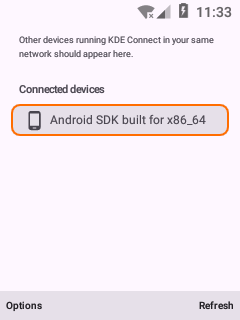<br><sub>1. Device list</sub></td><td align="center">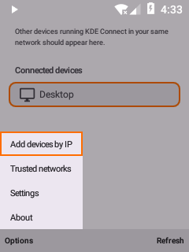<br><sub>2. Options menu</sub></td><td align="center">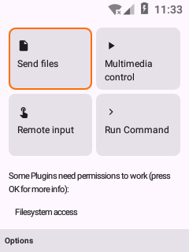<br><sub>3. Device</sub></td></tr>
  <tr><td align="center">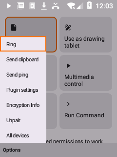<br><sub>4. Device options</sub></td><td align="center">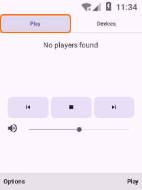<br><sub>5. Media remote</sub></td><td align="center">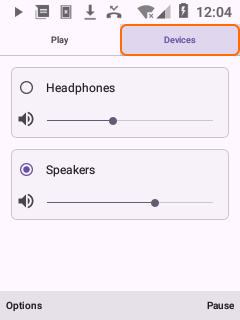<br><sub>6. PC volume</sub></td></tr>
  <tr><td align="center">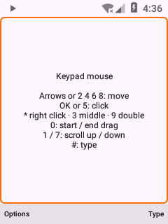<br><sub>7. Keypad mouse</sub></td><td align="center">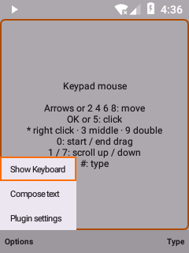<br><sub>8. Mouse options</sub></td><td align="center">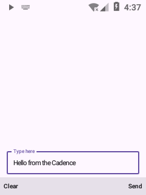<br><sub>9. Compose text</sub></td></tr>
  <tr><td align="center">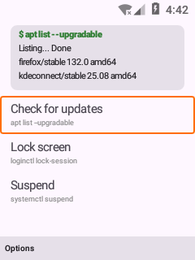<br><sub>10. Run Command</sub></td><td align="center">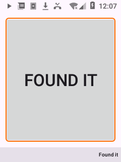<br><sub>11. Find my phone</sub></td><td align="center">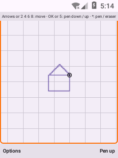<br><sub>12. Drawing tablet</sub></td></tr>
  <tr><td align="center">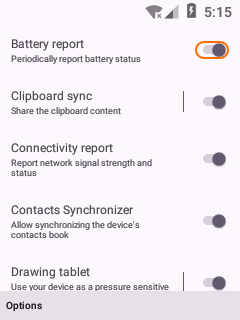<br><sub>13. Plugin settings</sub></td><td align="center">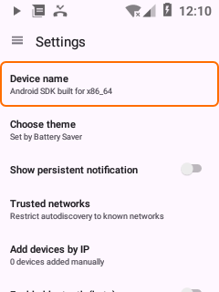<br><sub>14. Settings</sub></td><td align="center">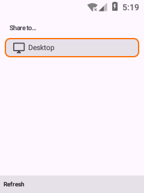<br><sub>15. Share</sub></td></tr>
</table>

1. **Device list**: opens with the first device focused (open the app)
2. **Options menu**: on top of the soft-key bar (Left soft key)
3. **Device**: first plugin focused (OK)
4. **Device options**: ring, ping, plugin settings, unpair (Left soft key)
5. **Media remote**: every control reachable, Play/Pause on the right key (Multimedia control)
6. **PC volume**: pick the output, mute, set the level (Devices tab)
7. **Keypad mouse**: the keypad drives the PC pointer (Remote input)
8. **Mouse options**: keyboard, compose, settings (Left soft key)
9. **Compose text**: Clear / Send on the soft keys (Options → Compose text)
10. **Run Command**: commands and their output from the PC (Run Command)
11. **Find my phone**: Found it on the right key (rung from the PC)
12. **Drawing tablet**: the keypad is the pen: 2 4 6 8 move, OK pen down/up (Use as drawing tablet)
13. **Plugin settings**: the ring hugs the toggle (Options → Plugin settings)
14. **Settings**: soft-key switch and calibration (Options → Settings)
15. **Share**: first device focused (share from any app)

## Speed on slow phones

Measured on an Android 7.1 emulator without hardware acceleration (a slow phone) holding 6,204 SMS in 82 conversations and 31 contacts. "Before" is the same app on upstream KDE Connect's code.

| | Before | Now |
|---|---|---|
| Whole conversation list sent to the desktop | 36.3 s | **10.2 s** |
| Contacts (vCards) sent to the desktop | 11.8 s | **4.2 s** |
| A text arrives: the desktop shows its notification | 3.6–7.2 s | **0.9–1.8 s** |
| A text sent from the desktop shows as sent | 4.7 s | **1–3.7 s** |
| Open a 3,000-message conversation (newest 50) | 0.7 s | **0.5 s** |
| Run command screen opens | 6.1 s | **2.6 s** |
| Share screen opens | 5.5 s | **3.4 s** |
| Drawing tablet screen opens | 3.3 s | **1.8 s** |
| App size (release APK) | 7.4 MB | **6.1 MB** |
| Album art in memory, per cover (240×320 screen) | 1024 px, ~4 MB | **320 px, ~0.4 MB** |

The table above compares debug builds. The release build (what you install), on the same emulator:

| Release build | |
|---|---|
| Whole conversation list sent to the desktop | **2.2–3.2 s** |
| Contacts (vCards) sent | **1.7 s** |
| A text arrives: the desktop shows its notification | **0.9–2.7 s** |
| Open a 3,000-message conversation (newest 50) | **0.2 s** |
| Screens open (device list / Share / Run command / Presentation / Drawing tablet) | **2.7 / 2.7 / 3.0 / 2.1 / 1.2 s** |
| Cold start | **2.2–2.9 s** |
| Memory (PSS) | **36 MB** |
| CPU while connected and idle | **~40 ms per minute** |

- **Texts:** a text's notification reaches the desktop as soon as the SMS arrives instead of waiting for the SMS app, which on a slow phone posts its own seconds later; when it does, it updates that same desktop notification (adding Reply) without a second popup. The conversation list comes from the message database's own "newest message of every conversation" query (one query, computed with the database's indexes) instead of two queries per conversation, and goes to the desktop 10 conversations per packet after the first. New texts keep reaching the computer after Android kills the app in the background. A text sent from the computer shows up in its conversation there even on phones that don't store texts sent by other apps (issue #3). A setting in the SMS plugin, "Conversations sent to the computer" (All, newest 50, newest 20; All by default), makes each connect load only the newest conversations (issue #4). Another, "Picture messages (MMS) on the computer" (on by default), can leave picture messages out so only texts are synced, which is faster (issue #5).
- **Contacts** no longer hold up everything else from the computer while they are read; they are built from one database query and sent 50 at a time.
- **Lighter app:** every screen is plain Android views (Jetpack Compose is gone), and album art is loaded with plain Android code instead of two image and network libraries, decoded only as big as the screen.
- **Less work in the background:** the plugin list is built off the UI thread at start, notifications are built off the UI thread, MMS photo thumbnails are decoded at thumbnail size instead of full resolution, Find my phone prepares its ringtone only when it rings, network discovery runs for a minute after each network change or Refresh instead of all the time, the device screen keeps its views when nothing on it changed (about 40% less layout and drawing at start), and whether the phone is a keypad phone is worked out once instead of on every screen build, and the navigation drawer is built only when it is shown (never on a keypad phone, where Options has its entries); the device screen's tiles are plain views drawn like Material cards, and the app's own certificate name is read without loading BouncyCastle at start (cold start median 4.8 s to 4.3 s on the emulator). Start no longer waits on the main thread for the system's mDNS service (about 0.3 s on the emulator), for the "add device by IP" list to be looked up, or for the list of SIM cards, and it reads all its settings files at once instead of one after another.

**Releases:** every push to master that touches the app publishes a release with the arm64 and armv7 APKs, with its own version: 1.37.N, where N goes up with every build. A newer push cancels a build still running, and each release's notes list every commit since the previous release.

**Developing:** testing runs on an Android emulator with a stand-in desktop: [`tests/devices/`](tests/devices/) has the keypad tour (every screen reached with keys only, per phone), [`tests/perf/`](tests/perf/) the speed and feature checks.

## Credits

- **[Yapchik](https://github.com/theOnionsAreWatching/yapchik)** by theOnionsAreWatching: the soft-key engine. It finds the phone's soft keys and draws the on-screen soft-key bar with their labels. It is included as source in [`yapchik/`](yapchik/) under the GNU LGPL v3 or later (see [`yapchik/LICENSE`](yapchik/LICENSE) and [`yapchik/NOTICE`](yapchik/NOTICE)).
- **[vela-dpad](https://github.com/alltechdev/vela-dpad)**: the keypad design this build copies (soft-key layout, focus rings, menus, dialogs).
- **[KDE Connect](https://invent.kde.org/network/kdeconnect-android/)** by the KDE Community: the app itself (GPL v2 / v3).

---

# KDE Connect - Android app

KDE Connect is a multi-platform app that allows your devices to communicate (eg: your phone and your computer).

## (Some) Features
- **Shared clipboard**: copy and paste between your phone and your computer (or any other device).
- **Notification sync**: Read and reply to your Android notifications from the desktop.
- **Share files and URLs** instantly from one device to another.
- **Multimedia remote control**: Use your phone as a remote for Linux media players.
- **Virtual touchpad**: Use your phone screen as your computer's touchpad and keyboard.

All this without wires, over the already existing Wi-Fi network, and using TLS encryption.

## About this app

This is a native Android port of the KDE Connect Qt app. You will find a more complete readme about KDE Connect [here](https://invent.kde.org/network/kdeconnect-kde/).

## How to install this app

You can install this app from the [Play Store](https://play.google.com/store/apps/details?id=org.kde.kdeconnect_tp) as well as [F-Droid](https://f-droid.org/repository/browse/?fdid=org.kde.kdeconnect_tp). Note you will also need to install the [desktop app](https://invent.kde.org/network/kdeconnect-kde) for it to work.

## Contributing

A lot of useful information, including how to get started working on KDE Connect and how to connect with the current developers, is on our [KDE Community Wiki page](https://community.kde.org/KDEConnect)

For bug reporting, please use [KDE's Bugzilla](https://bugs.kde.org). Please do not use the issue tracker in GitLab since we want to keep everything in one place.

To contribute patches, use [KDE Connect's Gitlab](https://invent.kde.org/network/kdeconnect-android/).
On Gitlab (as well as on our [old Phabricator](https://phabricator.kde.org/tag/kde_connect/)) you can find a task list with stuff to do and links to other relevant resources.
It is a good idea to also subscribe to the [KDE Connect mailing list](https://mail.kde.org/mailman/listinfo/kdeconnect).

Please know that all translations for all KDE apps are handled by the [localization team](https://l10n.kde.org/). If you would like to submit a translation, that should be done by working with the proper team for that language.

## License
[GNU GPL v2](https://www.gnu.org/licenses/gpl-2.0.html) and [GNU GPL v3](https://www.gnu.org/licenses/gpl-3.0.html)

If you are reading this from GitHub, you should know that this is just a mirror of the [KDE Project repo](https://invent.kde.org/network/kdeconnect-android/).
