# Kyocera Cadence S2720

Last gate run:

```
  COVERED  01 device-list
  COVERED  02 list-options
  COVERED  03 add-devices-by-ip
  COVERED  04 add-device-dialog
  COVERED  05 trusted-networks
  COVERED  06 about
  COVERED  07 not-paired
  COVERED  08 device
  COVERED  09 device-options
  COVERED  10 plugin-settings
  COVERED  11 media
  COVERED  12 pc-volume
  COVERED  13 keypad-mouse
  COVERED  14 mouse-options
  COVERED  15 compose-text
  COVERED  16 run-command
  COVERED  17 run-command-output
  COVERED  18 find-my-phone
  COVERED  19 drawing-tablet
  COVERED  20 presentation-remote
  COVERED  21 settings
  COVERED  22 share
RESULT kyocera-cadence-s2720 (240x320 @ 160, Android 7.1.1): FULLY COVERED (22/22) - full run 17/22, the 5 misses (gate bugs) rerun green with PHASES; all frames checked by eye
```

Last partial run (only some phases; its frames replace those phases' frames below):

```
  COVERED  09 device-options
  COVERED  10 plugin-settings
RESULT kyocera-cadence-s2720 (240x320 @ 160, Android 7.1.1): PARTIAL (2 covered, 0 missed; phases: device)
```

## screenshots/full

<table align="center">
  <tr><td align="center">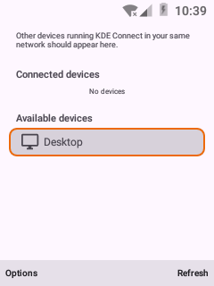<br><sub>1. Device list</sub></td><td align="center">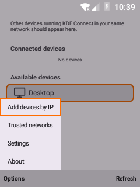<br><sub>2. List options</sub></td><td align="center">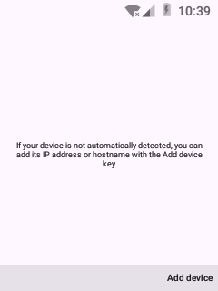<br><sub>3. Add devices by ip</sub></td></tr>
  <tr><td align="center">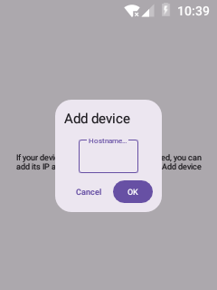<br><sub>4. Add device dialog</sub></td><td align="center">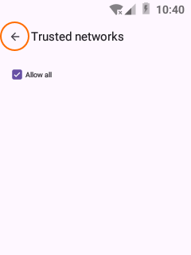<br><sub>5. Trusted networks</sub></td><td align="center">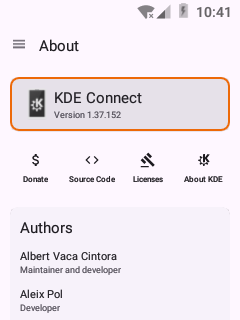<br><sub>6. About</sub></td></tr>
  <tr><td align="center">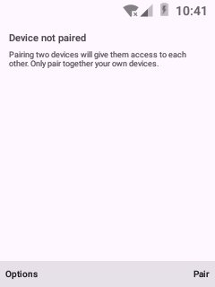<br><sub>7. Not paired</sub></td><td align="center">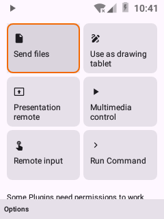<br><sub>8. Device</sub></td><td align="center">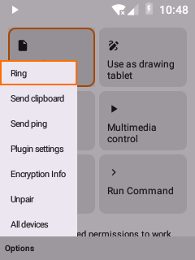<br><sub>9. Device options</sub></td></tr>
  <tr><td align="center">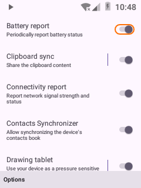<br><sub>10. Plugin settings</sub></td><td align="center">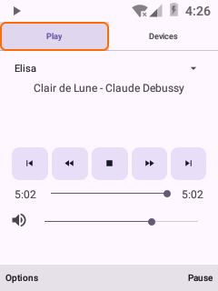<br><sub>11. Media</sub></td><td align="center">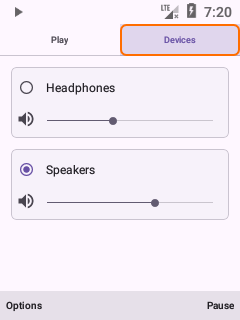<br><sub>12. Pc volume</sub></td></tr>
  <tr><td align="center">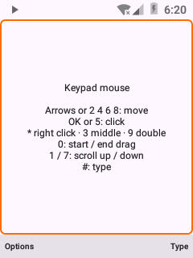<br><sub>13. Keypad mouse</sub></td><td align="center">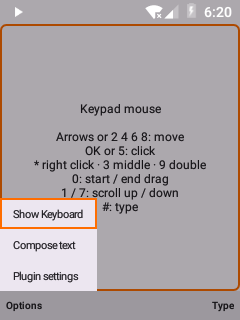<br><sub>14. Mouse options</sub></td><td align="center">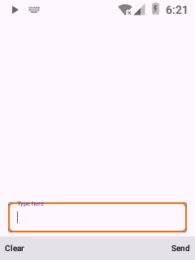<br><sub>15. Compose text</sub></td></tr>
  <tr><td align="center">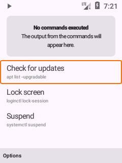<br><sub>16. Run command</sub></td><td align="center">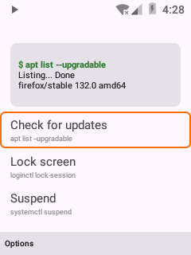<br><sub>17. Run command output</sub></td><td align="center">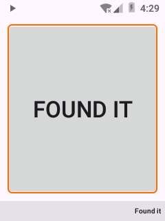<br><sub>18. Find my phone</sub></td></tr>
  <tr><td align="center">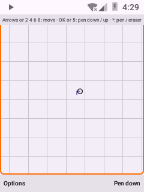<br><sub>19. Drawing tablet</sub></td><td align="center">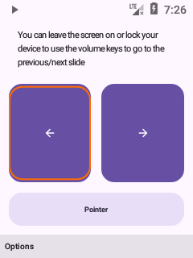<br><sub>20. Presentation remote</sub></td><td align="center">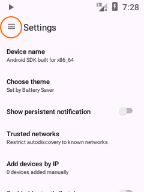<br><sub>21. Settings</sub></td></tr>
  <tr><td align="center">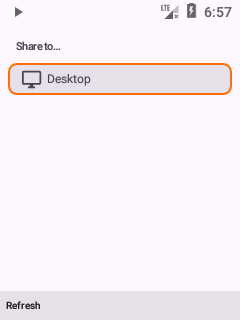<br><sub>22. Share</sub></td><td align="center">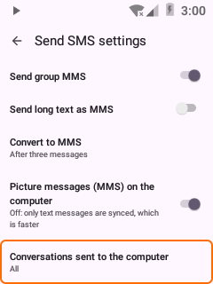<br><sub>23. Sms settings</sub></td><td align="center">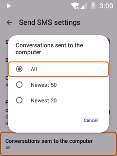<br><sub>24. Sms conversation limit</sub></td></tr>
</table>
