# Kyocera e4810

## screenshots/full

<table align="center">
  <tr><td align="center">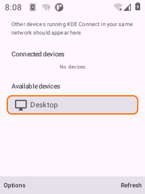 1. Device list</td><td align="center">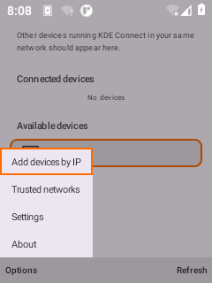 2. List options</td><td align="center">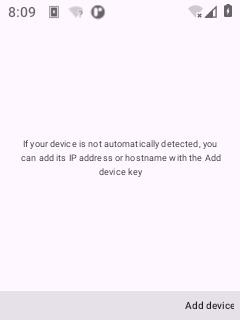 3. Add devices by ip</td></tr>
  <tr><td align="center">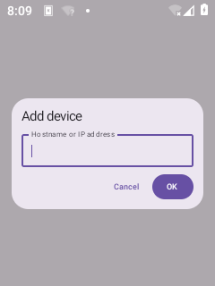 4. Add device dialog</td><td align="center"> 6. About</td><td align="center">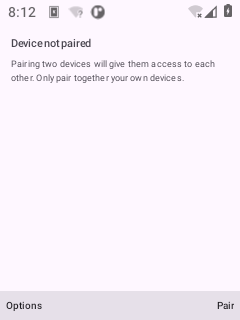 7. Not paired</td></tr>
  <tr><td align="center">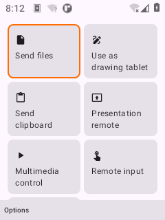 8. Device</td><td align="center">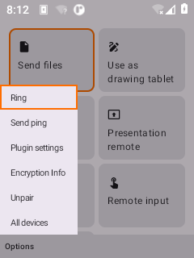 9. Device options</td><td align="center">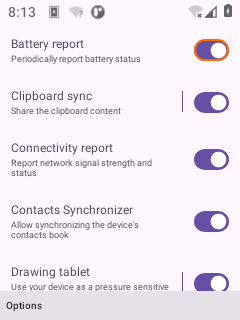 10. Plugin settings</td></tr>
  <tr><td align="center"> 11. Media</td><td align="center">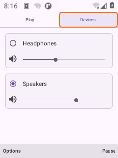 12. Pc volume</td><td align="center">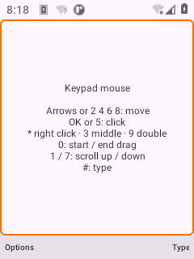 13. Keypad mouse</td></tr>
  <tr><td align="center">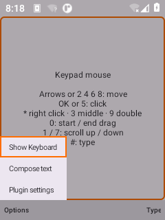 14. Mouse options</td><td align="center">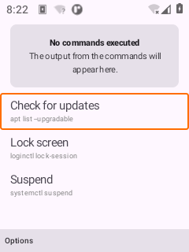 16. Run command</td><td align="center">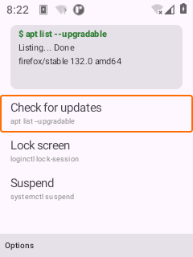 17. Run command output</td></tr>
</table>
